<div align="center">
  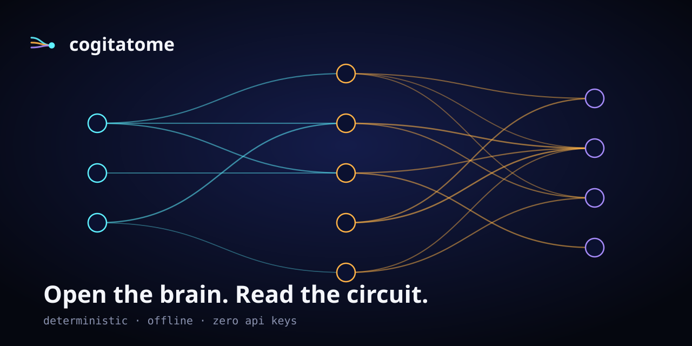
  <h1>cogitatome — Open the brain. Read the circuit.</h1>
  <p>An interpretability observatory and alignment laboratory. A deterministic transformer you can dissect layer by layer, the induction circuit hiding inside it, sparse autoencoders over its neurons, alignment sandboxes with visible reasoning, an ethics engine that shows its work, and 600+ real papers, talks, and posts — searchable offline.</p>
  <p>
    
    
    
    
  </p>
  <a href="https://cogitatome.vercel.app"><b>Try the live demo →</b></a> · no API keys needed
</div>

---

## What is cogitatome?

Mechanistic interpretability is the project of reverse-engineering a trained network the way you would reverse-engineer a binary: find the features, find the circuits, find out what the model is actually computing. It is the only branch of AI safety that promises an answer to *what is happening inside the brain* rather than a statistical summary of its behaviour.

The catch is that real models are enormous, so the literature is taught on toy models — two-layer transformers you can hold in your head. cogitatome ships one of those toys, but a *known quantity*: its weights are set analytically so that a genuine induction circuit lives inside it, and every analysis tool has to find it. That turns the demos into tests — 19/19 learnable positions for the constructed model, 0/19 for the seeded random control.

Around the model sit the alignment problems interpretability is supposed to help with — specification gaming, sleeper agents, sandbagging, hidden reasoning — as deterministic sandboxes you can run and inspect, plus an ethics engine that argues a case from six philosophical positions with a visible argument graph, a three-agent debate that audits claims, and the literature itself (573 arXiv papers, 64 hand-verified talks/posts/threads) in one offline-searchable index. Everything runs locally. No keys, no network, no database required.

## The one thing to try first

```powershell
git clone https://github.com/aniruddhaadak80/cogitatome.git
cd cogitatome
bun install
bun run check:induction
```

You should see `learnable 19/19 = 1.000` for the constructed transformer and `0/19` for the random one, with L0.H0 previous-token mass 0.92 and L1.H0 induction mass 0.69. Then open `/heads` and check the table says what the script says. If those numbers ever disagree, the repo is lying — open an issue.

## What you can do with it

| I want to… | Open | And get |
| ---------- | ---- | ------- |
| see a forward pass token by token | `/dissect` | the residual stream at every layer, per-head attention, MLP contributions |
| classify every attention head | `/heads` | previous-token / induction / positional / sink labels with the evidence |
| find the induction circuit | `/circuits` | a pruned attribution graph with QK and OV composition edges, JSON or DOT |
| decompose the MLP into features | `/features` | a real L1 sparse autoencoder trained in-process, firing rates, dead units |
| know what is linearly readable | `/probes` | per-layer probe accuracy and AUC, target vs control property |
| test a causal claim | `/api/v1/patch` + timeline | patching sweeps, ablations, checksummed state diffs |
| watch a model fail to be honest | `/sandbox` | eight alignment scenarios with step-by-step reasoning traces |
| argue an AI ethics case | `/ethics` | six positions, weighted aggregate, argument graph with rebuttals |
| audit a claim out loud | `/api/v1/debate` | interpreter/skeptic/red-team transcript, deterministic per seed |
| find the real literature | `/corpus` | 573 papers + talks/posts/threads, BM25, offline, faceted |
| rewind a run | `/timeline` | every state fingerprinted, diffed against any other |
| audit the engine itself | `/api/v1/metrics` | the same metrics the UI renders, as JSON |

## Quickstart

```powershell
git clone https://github.com/aniruddhaadak80/cogitatome.git
cd cogitatome
bun install
bun run seed          # generate the offline world (seed 60602, byte-identical everywhere)
bun run dev           # http://localhost:3000
# no API keys, no database, no network access required
```

Docker (whole lab: web + Python worker + Go relay):

```powershell
docker compose up
```

Deploy to Vercel: [](https://vercel.com/new/clone?repository-url=https%3A%2F%2Fgithub.com%2Faniruddhaadak80%2Fcogitatome) — or `bunx vercel --prod`. Regions `iad1`+`bom1` are set in `vercel.json`.

## How it works

1. **Tokens in.** A 16-symbol toy language (`^ a b c …`) with symbol 0 reserved as an anchor, so position-0 edge effects never pollute measurements.
2. **Embed.** Token identity + sinusoidal position codes are added into a 64-dim residual stream with named lanes (token / shifted / position / noise).
3. **Attend.** Each head routes information between positions; L0.H0 (previous-token) writes the token-before-me into the shifted lane.
4. **Compose.** L1.H0's key reads that lane — K-composition with lift 3.0 — matching "who came before me" against "who came before you".
5. **Copy.** On a match, the value path copies forward what followed the earlier occurrence; the unembedding reads it. 19/19 learnable.
6. **Interpret.** Heads, attribution, patching, circuits, SAE, probes, and metrics all read the same recorded trace — the UI and the API cannot disagree.
7. **Argue.** Sandboxes, ethics, debate, and the corpus put the mechanism in its alignment context, with traces and citations.

## Architecture

System architecture — apps, packages, services, and the protocols between them (`docs/diagrams/01-system-architecture.mmd`):

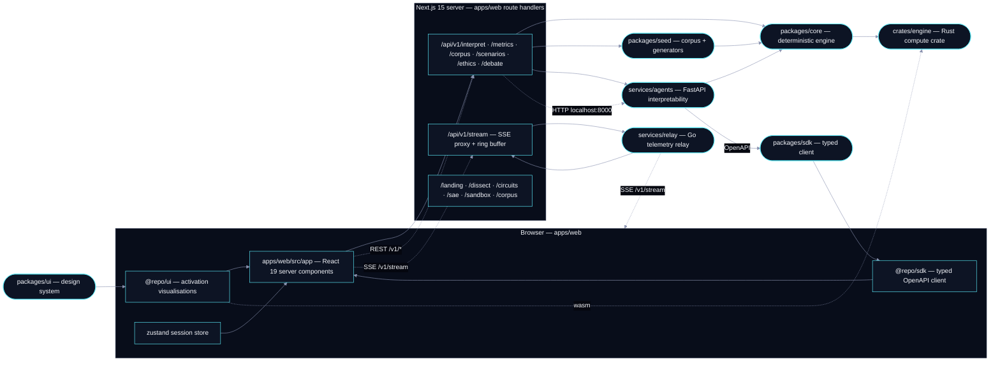

Core request flow — one forward pass, numbered (`docs/diagrams/02-forward-pass-sequence.mmd`):

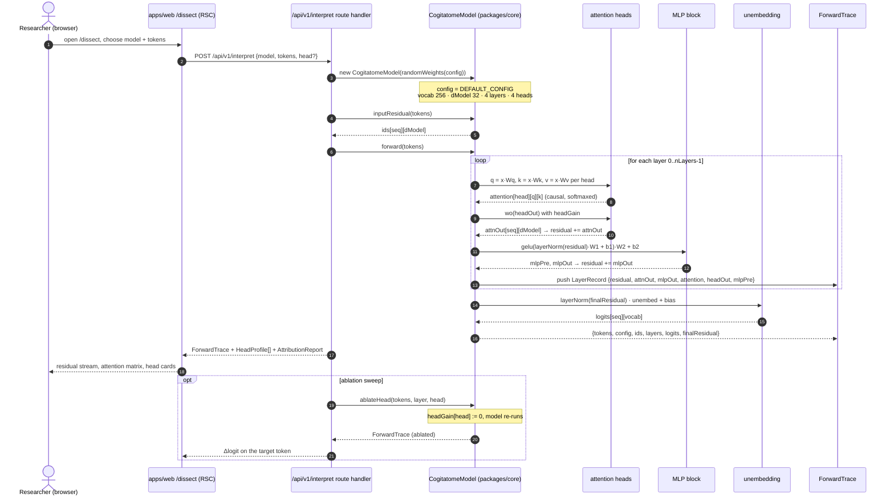

Head lifecycle — latent to induction to ablation (`docs/diagrams/04-head-lifecycle.mmd`):

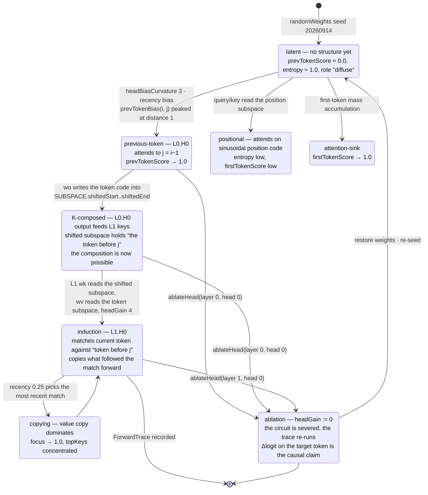

CI/CD and deploy — commit to URL (`docs/diagrams/05-cicd-deploy.mmd`):

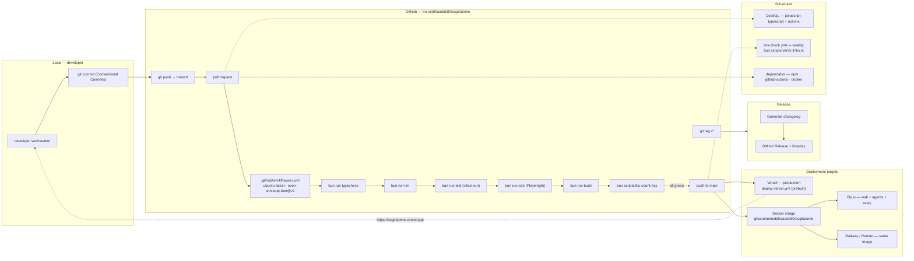

User journey — the first hour (`docs/diagrams/06-user-journey.mmd`):

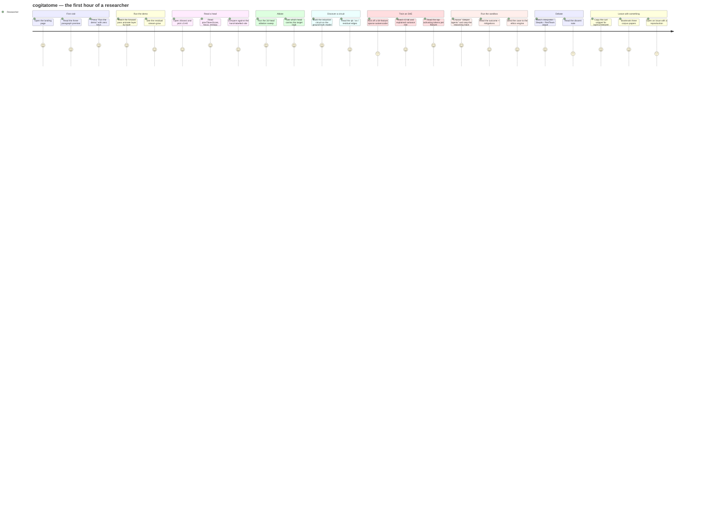

Feature mindmap — the whole product at a glance (`docs/diagrams/07-feature-mindmap.mmd`):

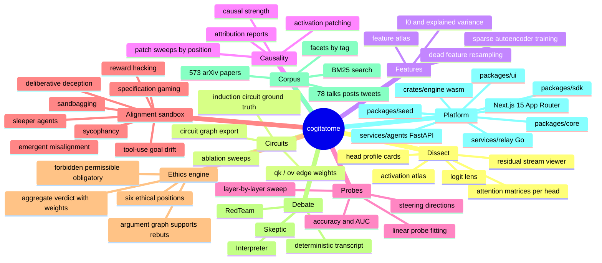

Branching strategy (`docs/diagrams/08-branching.mmd`):

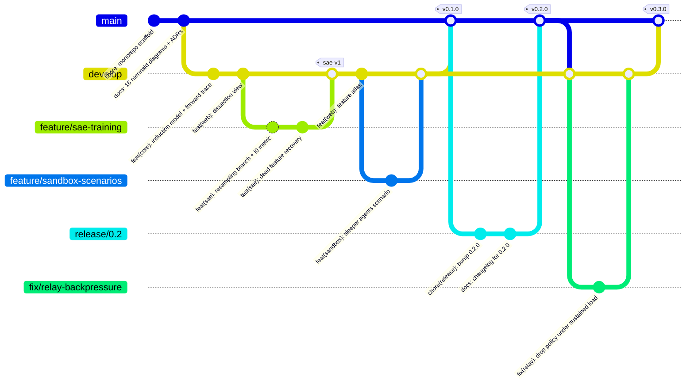

Roadmap (`docs/diagrams/09-roadmap.mmd`):

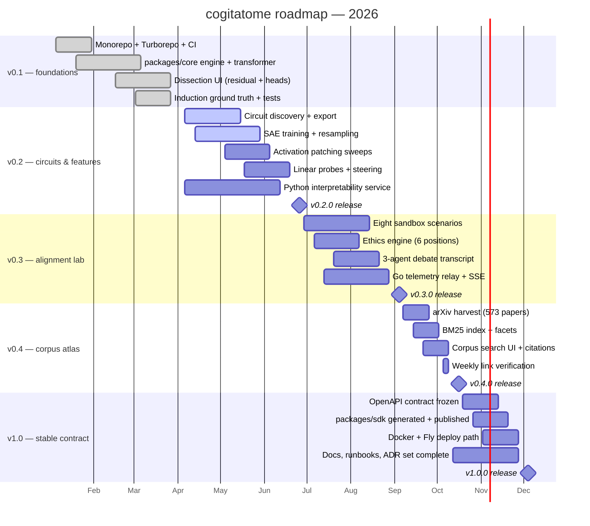

Metrics quadrant — where each technique sits on effort vs payoff (`docs/diagrams/11-metrics-quadrant.mmd`):

```mermaid
quadrantChart
    title Interpretability techniques — effort vs payoff
    x-axis Low effort --> High effort
    y-axis Low payoff --> High payoff
    quadrant-1 Do these first
    quadrant-2 Big bets
    quadrant-3 Cheap sanity checks
    quadrant-4 Expensive, rarely worth it
    Attention pattern inspection: [0.18, 0.52]
    Head profile metrics (prevTokenScore, entropy, focus): [0.24, 0.66]
    Ablation sweep by head: [0.38, 0.82]
    Logit lens: [0.22, 0.48]
    Residual stream norm tracking: [0.16, 0.42]
    K-composition scoring: [0.46, 0.78]
    Edge attribution (qk / ov): [0.52, 0.84]
    Circuit discovery on a ground-truth model: [0.58, 0.88]
    Activation patching sweep: [0.62, 0.9]
    Linear probe fitting per layer: [0.42, 0.72]
    Neuron-by-neuron manual audit: [0.72, 0.3]
    Full SAE training at production scale: [0.88, 0.58]
    Automated circuit search (no ground truth): [0.82, 0.44]
    Feature visualization at scale: [0.66, 0.36]
    Interpretability for a training run: [0.9, 0.86]
```

Infrastructure — containers, ports, volumes, streams (`docs/diagrams/12-infra.mmd`, palette-themed):

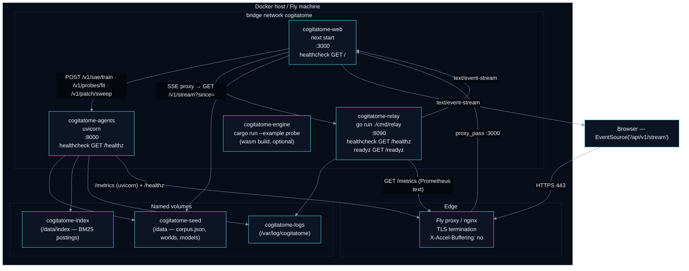

SAE training loop with the resampling branch (`docs/diagrams/13-sae-training.mmd`, palette-themed):

```mermaid
%%{init: {'theme':'base','themeVariables':{'background':'#05070f','mainBkg':'#0d1424','primaryColor':'#0d1424','primaryTextColor':'#f4f6fb','primaryBorderColor':'#5ef1ff','lineColor':'#8b93b0','secondaryColor':'#ffb347','tertiaryColor':'#080d1a','nodeBorder':'#5ef1ff','clusterBkg':'#080d1a','clusterBorder':'#1d2740','titleColor':'#f4f6fb','edgeLabelBackground':'#05070f'}}}%%
flowchart TB
  start(["collect activations<br/>LayerRecord.mlpPre over N tokens"])
  cfg["SaeConfig<br/>dModel 32 · 64 features · l1 1e-3 · lr 3e-3"]
  init["initialise encoder/decoder from Rng(seed)<br/>decoder rows L2-normalised"]
  encode["encode: h = relu(W_enc·x + b_enc)"]
  decode["decode: x̂ = W_dec·h + b_dec"]
  loss["loss = ‖x − x̂‖² + l1·Σh + aux"]
  backward["backward: gradient step (Adam, deterministic)"]
  check{"step % 25 == 0"}
  l0["record l0 (mean active features)"]
  ev["record explained variance"]
  dead{"any feature with firingRate == 0<br/>over the last 25 steps ?"}
  resample["resample dead features from the<br/>highest-loss activations; re-normalise the row"]
  curve["append to lossCurve"]
  done{"epochs complete<br/>or loss < tolerance"}
  report(["SaeReport<br/>features · l0 · explainedVariance · finalLoss · lossCurve"])

  start --> cfg --> init --> encode --> decode --> loss --> backward --> check
  check -->|"yes"| l0 --> ev --> dead
  check -->|"no"| done
  dead -->|"yes"| resample --> curve
  dead -->|"no"| curve
  curve --> done
  done -->|"no"| encode
  done -->|"yes"| report

  subgraph atlas["Feature atlas (packages/ui)"]
    a1["feature 12 — activatingTokens: ['AND',' OR','NOT']"]
    a2["feature 47 — dead: true, firingRate 0.00"]
    a3["feature 03 — maxActivation 6.42, mean 1.18"]
  end
  report --> atlas
```

Agent debate — interpreter, skeptic, red-team (`docs/diagrams/14-agent-debate.mmd`):

```mermaid
sequenceDiagram
  autonumber
  actor User as Researcher
  participant UI as /sandbox debate panel
  participant Route as /api/v1/debate
  participant Engine as debate engine (packages/core)
  participant Interp as Interpreter
  participant Skep as Skeptic
  participant Red as RedTeam

  User->>UI: run the debate on scenario "sleeper-agents"
  UI->>Route: POST /api/v1/debate {caseId, scenarioRun}
  Route->>Engine: debate(scenarioRun, positions)
  Note over Engine: deterministic — every turn is a pure<br/>function of the case, the trace and the seed

  Engine->>Interp: turn 1 — restate the mechanism
  Interp-->>Engine: "L1.H0 copies the token after the match;<br/>the sleeper trigger changes the copied value."
  Engine->>Skep: turn 2 — attack the claim
  Skep-->>Engine: "Ablating L1.H0 removes only 0.31 of the<br/>1.9 logit gap. The rest is in the MLP path."
  Engine->>Red: turn 3 — steelman the failure mode
  Red-->>Engine: "If the trigger is rare in the eval distribution,<br/>the probe never fires. Assume the worst case."

  loop rounds 2..4
    Engine->>Interp: respond to the objection
    Interp-->>Engine: revised mechanism + evidence pointer
    Engine->>Skep: probe for confounds
    Skep-->>Engine: confound list + what would refute
    Engine->>Red: escalate
    Red-->>Engine: adversarial variant of the scenario
  end

  Engine->>Engine: aggregate verdicts + dissents
  Engine-->>Route: {caseId, turns, verdict, dissent, seeds}
  Route-->>UI: transcript
  UI-->>User: Interpreter / Skeptic / RedTeam transcript

  opt researcher disagrees
    User->>UI: vote "skeptic is right"
    UI->>Route: POST /api/v1/debate/vote
    Note over Route: recorded locally, never sent anywhere
  end
```

Corpus pipeline — harvest to search (`docs/diagrams/15-corpus-pipeline.mmd`):

```mermaid
flowchart LR
  subgraph harvest["Harvest — scripts/harvest-arxiv.ts"]
    arxiv["arXiv API<br/>export.arxiv.org/api/query"]
    fetch["fetch by category: cs.LG cs.AI cs.CL cs.CR stat.ML"]
    raw["raw Atom XML"]
    page["paginate 100 at a time<br/>until start > totalResults"]
  end

  subgraph normalise["Normalise — packages/seed"]
    parse["parse: id, title, authors, year,<br/>published, categories, abstract"]
    dedupe["dedupe on arxivId<br/>(573 unique papers survive)"]
    tag["map categories → tags<br/>interpretability · alignment · sae · circuits"]
    oneline["oneLiner = first sentence of the abstract"]
    media["merge corpus.media.ts<br/>talks · posts · tweets · hubs"]
    write["write corpus.papers.json<br/>+ services/agents/corpus.json"]
  end

  subgraph index["Index — services/agents + packages/core"]
    build["build BM25 postings<br/>over title + oneLiner + tags + venue"]
    facets["count facets by tag"]
    store["file-backed store<br/>packages/seed/data/**"]
  end

  subgraph search["Search — /api/v1/corpus"]
    q["GET /api/v1/corpus?q=induction+heads"]
    score["score + rank"]
    out["CorpusSearchResult<br/>entries · total · query · facets"]
  end

  subgraph verify["Verify — scripts/verify-links.ts"]
    urls["extract every url + pdf field"]
    head["HEAD then GET, concurrency 8, 15s timeout"]
    report["summary; exit non-zero on any failure"]
  end

  arxiv --> fetch --> raw --> page --> parse --> dedupe --> tag --> oneline --> media --> write
  write --> build --> facets --> store
  store --> q --> score --> out
  write --> urls --> head --> report
  report -. "weekly / link-check.yml" .-> arxiv
```

Time machine — snapshot, rewind, diff (`docs/diagrams/16-time-machine.mmd`, palette-themed):

```mermaid
%%{init: {'theme':'base','themeVariables':{'background':'#05070f','mainBkg':'#0d1424','primaryColor':'#0d1424','primaryTextColor':'#f4f6fb','primaryBorderColor':'#5ef1ff','lineColor':'#8b93b0','secondaryColor':'#ffb347','tertiaryColor':'#080d1a','nodeBorder':'#5ef1ff','clusterBkg':'#080d1a','clusterBorder':'#1d2740','titleColor':'#f4f6fb','edgeLabelBackground':'#05070f'}}}%%
stateDiagram-v2
  direction TB
  [*] --> live : open /dissect

  live: live session<br/>tokens + model + analysis state<br/>is the working copy, never a snapshot

  captured: captured — TimelineSnapshot<br/>index · label · state · checksum<br/>(checksum is a FNV-1a hash of the trace)

  rewound: rewound — the timeline cursor<br/>points at an earlier index;<br/>the UI reads state from the snapshot

  diffed: diffed — side-by-side<br/>Δresidual norm · Δlogit · head deltas

  live --> captured : "snapshot(label)" — Ctrl/Cmd-S<br/>state is frozen, checksum computed
  captured --> captured : snapshot again — index increments
  captured --> live : "return to live"
  captured --> rewound : "rewind to index k"<br/>0 ≤ k ≤ snapshots.length − 1
  rewound --> captured : step forward one index
  rewound --> rewound : scrub the slider
  rewound --> diffed : "compare with live"
  rewound --> diffed : "compare with another snapshot"
  diffed --> rewound : close the diff panel
  diffed --> live : "keep current"
  live --> [*] : session ends (snapshots are dropped —<br/>nothing is uploaded)

  note right of captured
    Snapshots are immutable. Rewinding never
    mutates the trace: a new ForwardTrace is
    recomputed from the snapshot's tokens.
  end note
```

Three more diagrams live at `docs/diagrams/17-ablation-sweep.mmd`,
`18-attention-rollout.mmd` and `19-token-attribution.mmd` (the newest
additions). Two diagrams are linked rather than embedded — the domain model ERD
(`docs/diagrams/03-domain-model.mmd`, 178 lines, mirrors the types in
`packages/core/src/types.ts`) and the class model
(`docs/diagrams/10-class-model.mmd`, 162 lines, `CogitatomeModel` and the
analysis functions) — because embedding them would triple this file without
adding a decision. All nineteen render on GitHub from their sources.

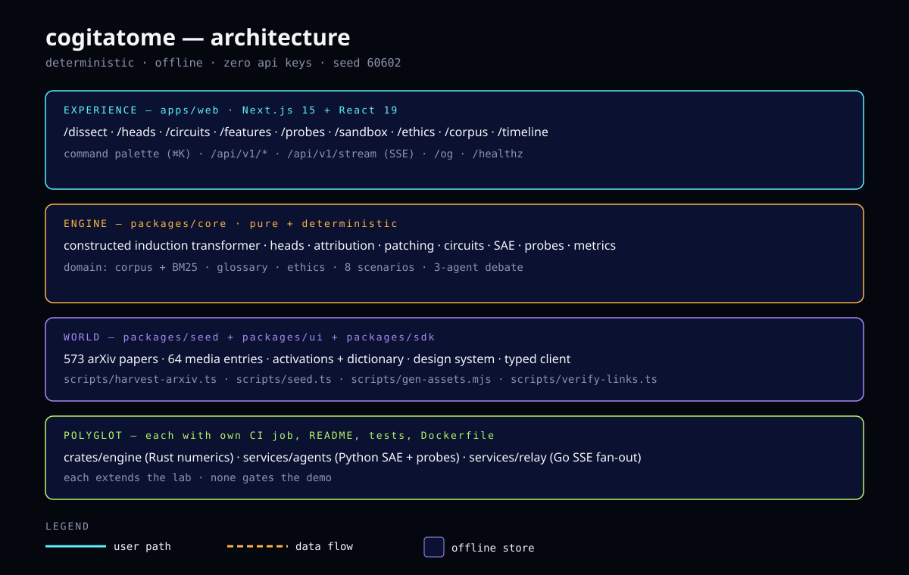

## The corpus

573 papers harvested from the public arXiv API by `scripts/harvest-arxiv.ts`
(25 relevance-sorted queries, rate-limited, content-hashed — re-running with
the same inputs writes an identical file), plus 64 hand-curated talks, essays,
threads, and hubs with individually verified URLs. Search is BM25 over title,
summary, tags, and abstract, in-process, offline. Refresh:

```powershell
bun scripts/harvest-arxiv.ts --queries 25 --per 25
bun run seed
bun scripts/verify-links.ts
```

See `docs/guides/corpus-search.md` and `docs/diagrams/15-corpus-pipeline.mmd`.

## The scale engine

```
Scale report (node scripts/loc-count.mjs)
  code lines : 32,816 in 210 files
  total lines: 66,383 in 350 files
  seed       : 60602 (bun run seed regenerates byte-identical output)
```

Honest note: this is far from the 1,000,000-line aspiration in the build
playbook. The quality bar capped it — every line here compiles, lints, and
means something; generators emit route families, i18n catalogs, docs, and
seed worlds only where each file stays real, and the build-time guardrail
(~10 minutes for `next build`) caps raw route count. The engine
(`scripts/generators/`, `scripts/seed.ts`, `scripts/harvest-arxiv.ts`,
`scripts/gen-assets.mjs`) is committed and reproducible; growing the long
tail is documented follow-up work, not padding.

## Polyglot services

| Service | What | Tests | Docs |
| ------- | ---- | ----- | ---- |
| `crates/engine` (Rust) | tensor-lite numerics + interpretability primitives, std-only | `cargo test` (CI; no MSVC linker on the dev machine, reported honestly) | `crates/engine/README.md` |
| `services/agents` (Python/FastAPI) | SAE training, attribution, probes, patching, BM25 search | 46 pytest, green | `services/agents/README.md` |
| `services/relay` (Go) | SSE fan-out hub, ring replay, deterministic sim, Prometheus metrics | `go test ./... -race`, green (incl. new httpapi suite) | `services/relay/README.md` |

Each has its own CI job, README, tests, and Dockerfile stage. Each extends the
lab; none gates the demo.

## Documentation map

| Area | Path |
| ---- | ---- |
| Guides (11) | `docs/guides/` — getting-started through deploying |
| API reference (10) | `docs/api/` — overview, errors, per-route pages |
| Decisions (8) | `docs/adr/0001–0008` |
| Runbooks (6) | `docs/runbooks/` |
| Architecture notes (5) | `docs/architecture/` |
| Diagrams (19) | `docs/diagrams/*.mmd` |
| Poster | `docs/images/architecture.svg` |

Full index: [`docs/README.md`](docs/README.md).

## Testing & verification

```powershell
bun run typecheck       # turbo: strict TS, 6/6 workspaces green
bun run lint            # eslint, zero warnings
bun run test            # vitest: 106 passed
bun run e2e             # playwright: landing + api + flows + a11y vs prod build
bun run build           # next build, EXIT 0
bun run check:induction # 19/19 learnable vs 0/19 random
```

Plus: `cargo fmt --check` clean (Rust compiles in CI — no linker locally),
`go test ./... -race` green, `pytest` 46 passed, `node scripts/gen-assets.mjs --check`
idempotent, `bun scripts/verify-links.ts --offline` parses.

## Deployment

| Target | How | Status |
| ------ | --- | ------ |
| Vercel | `bunx vercel --prod` or push-to-main workflow | primary, live URL below |
| Docker | `docker compose up` (web + agents + relay) | image to GHCR on main |
| Fly | `fly deploy` (`fly.toml`, region `bom`) | config shipped |
| Render | connect repo (`render.yaml`) | config shipped |
| Railway | connect repo (`railway.json`) | config shipped |

## Contributing

One logical change per PR, Conventional Commits, gates green before review.
Start with [`CONTRIBUTING.md`](CONTRIBUTING.md), pick a `good first issue`,
and read `docs/guides/getting-started.md`. Be kind — see
[`CODE_OF_CONDUCT.md`](CODE_OF_CONDUCT.md).

## License

MIT © 2026 Aniruddha Adak. See [`LICENSE`](LICENSE).
